# 24-Hour Phased Execution & Build Plan: HyperTPS

**Event Slug:** `cerebras-kimi-hackathon`  
**Hack Duration:** 24 Hours (Saturday, Nov 21 10:00 AM PT – Sunday, Nov 22 10:00 AM PT)  
**Owner Agent:** execution-planner  
**Audit Date:** 2026-11-20  
**Status:** Stage Gate D Approved  

---

## 1. 24-Hour Timeline & Parallel Workstream Breakdown

```mermaid
gantt
  title HyperTPS 24-Hour Build Sprint
  dateFormat X
  axisFormat %H:00

  section Setup & Warmup
  Environment & Org ID Validation :0, 2
  Kickoff Q&A & Baseline Benchmarks :1, 3

  section Workstream A (Bounty Engine)
  Resonant Prompt Formulation :2, 6
  Speculative Acceptance Calibration :5, 9
  Multi-Run Statistical Verification :8, 12

  section Workstream B (OpenClaw Plugin)
  Middleware Architecture :4, 8
  128-Token Cache Aligner :7, 11
  Code Refactoring Pipeline :10, 15

  section Workstream C (UI & Visuals)
  Rich Terminal Gauge & Telemetry :8, 13
  Comparison Chart Generator (vs H100) :12, 16
  High-FPS Screen Capture & Demos :15, 18

  section Workstream D (Submission & Social)
  Discord Bounty Submission Packet :17, 19
  Reddit Technical Deep Dive Post :18, 21
  X Viral Video Thread :19, 22
  Final Compliance Audit & Code Freeze :22, 24
```

---

## 2. Hour-by-Hour Phase Breakdown

### Phase 1: Setup & Baseline Telemetry (Hours 0 – 3 | 10:00 AM – 1:00 PM PT)
- **Goal:** Verify Cerebras private preview rate limits, model aliases, and baseline TPS.
- **Tasks:**
  - Attend official Discord kickoff Q&A.
  - Run baseline prompt tests against `api.cerebras.ai` on `kimi-k3.1-pro`.
  - Verify `time_info` extraction and confirm baseline TPS ($\sim 2,100$ TPS).
- **Gate:** Verified 200 OK response with populated `time_info.completion_time`.

### Phase 2: Core Engineering & Resonance Optimization (Hours 3 – 10 | 1:00 PM – 8:00 PM PT)
- **Goal:** Implement the candidate bounty prompts and OpenClaw middleware.
- **Tasks:**
  - Build `CacheBlockAligner` to enforce 128-token boundary padding.
  - Formulate and calibrate Candidate Alpha (Peak Bounty) and Candidate Beta (Real-world code refactoring).
  - Verify speculative draft acceptance $\alpha > 0.95$ and generation TPS $> 3,000$ TPS.
  - Implement OpenClaw middleware plugin (`@openclaw/hyper-tps`).
- **Gate:** Consistent $>3,000$ TPS achieved on 10 consecutive runs.

### Phase 3: Telemetry Dashboard & Visual Demo Capture (Hours 10 – 16 | 8:00 PM – 2:00 AM PT)
- **Goal:** Create the visual assets that win the social audience tracks.
- **Tasks:**
  - Develop `hypertps.cli` featuring real-time ANSI speed dials and token streaming.
  - Generate automated comparative charts contrasting Cerebras WSE-3 vs Nvidia H100 (3,050 TPS vs 45 TPS).
  - Record high-framerate terminal demonstrations showing instant code streaming.
- **Gate:** Crisp 60fps video clips and verified benchmark charts exported.

### Phase 4: Packaging & Dry-Run Submission (Hours 16 – 20 | 2:00 AM – 6:00 AM PT)
- **Goal:** Package the repository and prepare all submission copies.
- **Tasks:**
  - Write complete open-source documentation (`README.md`, reproduction guide, license).
  - Package CLI as a turnkey Python module.
  - Draft Reddit technical deep-dive post for `r/cerebras`.
  - Draft X announcement thread tagging `@cerebras`, `@MoonshotAI`, and `@openclaw`.
- **Gate:** 1-command reproduction verified on clean test environment (`pip install . && hypertps test`).

### Phase 5: Submission, Social Publishing & Code Freeze (Hours 20 – 24 | 6:00 AM – 10:00 AM PT)
- **Goal:** Submit before deadline and initiate the organic social flywheel.
- **Tasks:**
  - Submit the official TPS Bounty entry in Cerebras Discord `#hackathon-chat` / `#hackathon-support`.
  - Publish the Reddit technical post on `r/cerebras`.
  - Post the announcement thread on X with video demos.
  - Code freeze and final submission audit.
- **Gate:** All entries live and verified before Sunday 10:00 AM PT cutoff.
