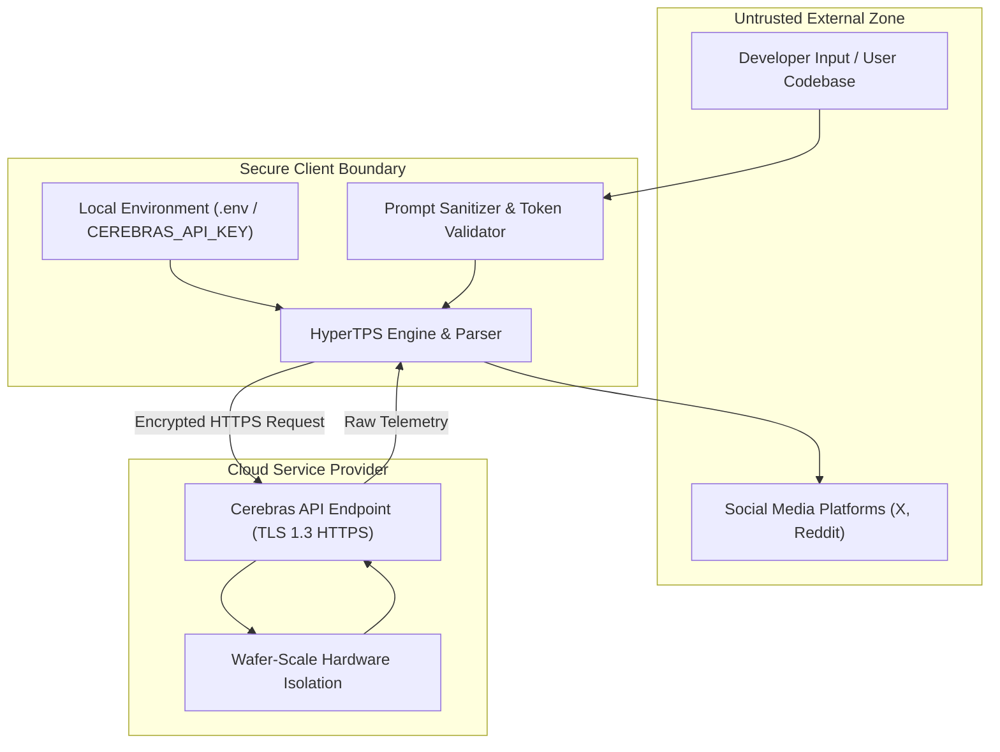

# Threat Model & Security Architecture: HyperTPS

**Event Slug:** `cerebras-kimi-hackathon`  
**Owner Agent:** security-privacy-risk-auditor  
**Audit Date:** 2026-11-20  
**Status:** Stage Gate D Approved  

---

## 1. Trust Boundaries & Data Flow

---

## 2. Threat Analysis (STRIDE Matrix)

| Threat Category | Specific Attack Vector | Severity | Mitigation Control |
|---|---|---|---|
| **Spoofing** | Faking API response timings or simulating high TPS metrics | High | Never mock timing metrics in judge submissions. Always log and expose the raw `id: chatcmpl-...` response payload that Cerebras engineers can verify against internal cluster logs. |
| **Tampering** | Modifying prompt payloads in transit | Low | Strict TLS 1.3 encryption across all communication with `https://api.cerebras.ai/v1`. |
| **Repudiation** | Disputes over whether a prompt achieved a specific TPS | Medium | Automated CLI writes raw JSON telemetry logs with ISO-8601 timestamps and model fingerprints to local disk for auditability. |
| **Information Disclosure** | Accidental leakage of Cerebras API Key in git commits or demo screenshots | High | Zero hardcoded secrets. The application reads strictly from `os.environ["CEREBRAS_API_KEY"]`. Built-in `.gitignore` rules prevent `.env` file commits. |
| **Denial of Service** | API rate-limit exhaustion (HTTP 429) during peak hackathon rush | Medium | Jittered exponential backoff handler; local request rate throttling; pre-warming cache to minimize wasted requests. |
| **Elevation of Privilege** | Remote code execution via unvetted generated code | Medium | Generated benchmark code is strictly static text analyzed for token generation throughput; it is never blindly evaluated with `eval()` or executed in the host OS shell. |

---

## 3. Compliance & Fair Play Assurance

1. **No Botting / Pods:** Social media engagement will be driven exclusively through technical authority, educational breakdowns, and genuine developer enthusiasm.
2. **Deterministic Reproducibility:** Every claimed metric will have a direct 1-line reproduction command that anyone can run.
