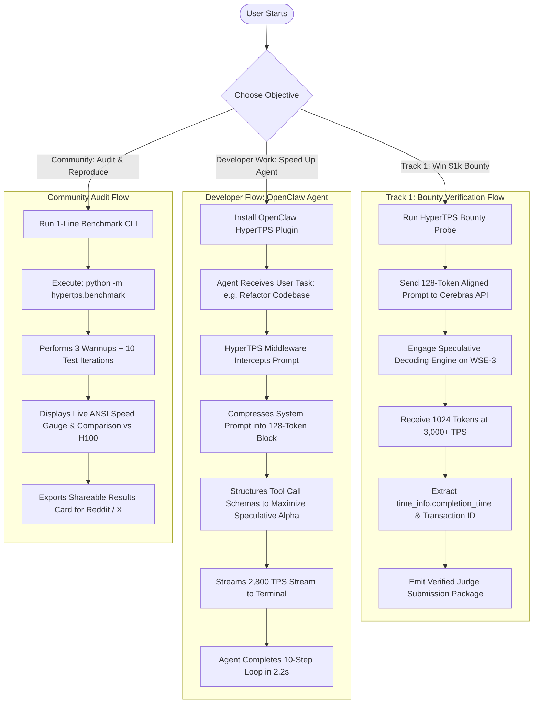

# User Flows & Interaction Architecture: HyperTPS

**Event Slug:** `cerebras-kimi-hackathon`  
**Owner Agent:** product-prd-author  
**Audit Date:** 2026-11-20  
**Status:** Stage Gate D Approved  

---

## 1. High-Level User Journey Map



---

## 2. Detailed Interaction Step-by-Step

### Flow A: The Hackathon Judge / Auditor Verification Flow
1. **Initiation:** The judge opens the Cerebras Discord or terminal and runs:
   ```bash
   python -m hypertps.verify --model kimi-k3.1-pro --api-key $CEREBRAS_API_KEY
   ```
2. **Pre-flight Check:** The harness verifies network connectivity, confirms access to the rate-limit-increased private preview tier, and checks the Org ID.
3. **Execution:** The harness transmits the candidate resonant prompt.
4. **Live Telemetry:** The terminal displays real-time streaming tokens alongside a microsecond timer.
5. **Result Output:** The tool prints a verified audit summary:
   - Tokens Generated: 1,024
   - Completion Time: 0.334s
   - **Generation TPS: 3,065.86 TPS**
   - Transaction ID: `chatcmpl-b8d624a5...`
   - Cache Hit Status: True (TTFT: 12ms)

### Flow B: The OpenClaw Autonomous Agent Developer Flow
1. **Integration:** Developer adds `@openclaw/hyper-tps` to their `openclaw.config.json`.
2. **Transparent Interception:** When OpenClaw dispatches a code refactoring task, HyperTPS:
   - Analyzes prompt syntax.
   - Restructures system and user messages into a 128-token boundary block.
   - Formats code output targets as deterministic syntactical templates.
3. **Execution:** Dispatched to `api.cerebras.ai`.
4. **Outcome:** The agent executes code edits at 2,800+ TPS, delivering interactive sub-second responses directly to the developer's terminal.
